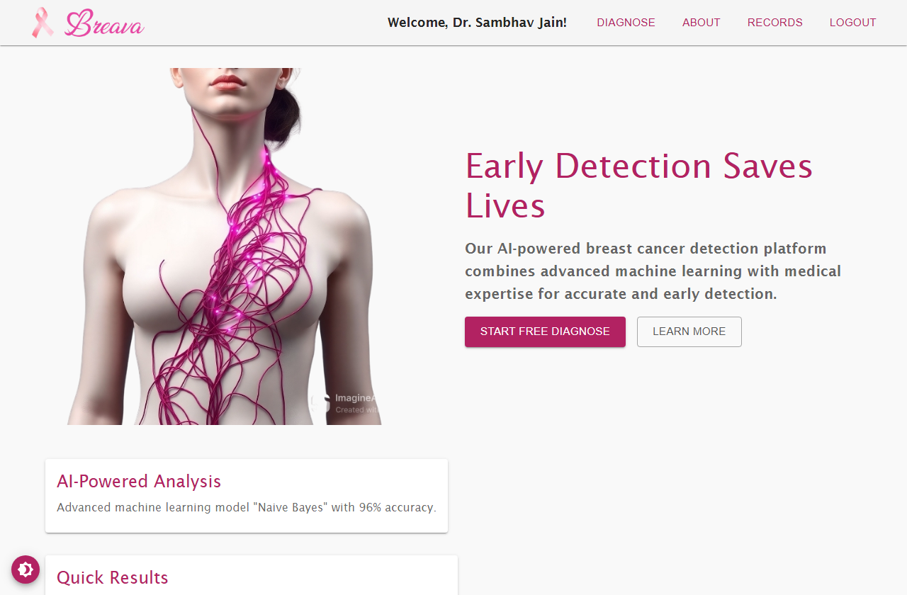
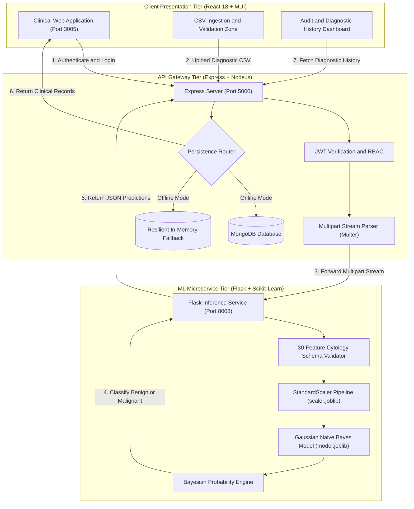

# Breast Cancer Diagnostic & Clinical Decision Platform

[](LICENSE)
[](https://www.python.org/)
[](https://nodejs.org/)
[](https://react.dev/)
[](https://scikit-learn.org/)
[]()
[]()

> A full-stack clinical intelligence platform and machine learning microservice for rapid, highly interpretable breast cancer cytology classification based on Fine Needle Aspirate (FNA) digitized nuclear features.

---

## System Overview



Breava transforms digitized Fine Needle Aspirate (FNA) cytological biopsies into rapid diagnostic predictions (Benign vs. Malignant) with 96.49% accuracy and 99.0% recall on the Wisconsin Diagnostic Breast Cancer (WDBC) benchmark. Designed as a modular, decoupled microservices architecture, Breava pairs a high-performance Flask machine learning engine with an Express/Node.js API gateway and a responsive React clinical interface.

### Key Engineering Highlights

- **Clinical-Grade ML Classifier**: Gaussian Naive Bayes model paired with a fitted Scikit-Learn `StandardScaler` pipeline, delivering sub-50ms inference times with zero GPU dependencies.
- **Microservice Decoupling**: Separation of clinical business logic (Node.js/Express) from ML inference workloads (Python/Flask) via multipart HTTP streaming.
- **Resilient Data Architecture**: Hybrid persistence layer that uses MongoDB for long-term patient audit logs with an automatic in-memory fallback store for offline development and local environments.
- **Zero-Friction Ingestion**: Batch patient CSV validation pipeline verifying 30 cytological nuclear morphometry features before model execution.
- **Security and Compliance Ready**: JWT-based session authentication with bcrypt salted password hashing and stateless request authorization.

---

## Architecture Flow



---

## Machine Learning Pipeline & Performance


### The Cytological Feature Vector
The model evaluates 30 quantitative features extracted from digitized images of fine needle aspirates of breast masses. Each cell nucleus is described across ten fundamental characteristics, each calculated by Mean, Standard Error (SE), and "Worst" (mean of the three largest values):

1. **Radius**: Mean of distances from center to perimeter points
2. **Texture**: Standard deviation of gray-scale values
3. **Perimeter**: Nuclear boundary length
4. **Area**: Nuclear cross-sectional area
5. **Smoothness**: Local variation in radius lengths
6. **Compactness**: Computed as `(perimeter^2 / area - 1.0)`
7. **Concavity**: Severity of concave portions of the contour
8. **Concave Points**: Number of concave portions of the contour
9. **Symmetry**: Nuclear symmetry balance
10. **Fractal Dimension**: "Coastline approximation" `(coastline - 1)`

### Validation Metrics

The Gaussian Naive Bayes model was evaluated against an independent 20% stratified holdout split from the Wisconsin Diagnostic Breast Cancer dataset:

| Metric | Score | Clinical Implication |
| :--- | :--- | :--- |
| **Accuracy** | **96.49%** | High overall diagnostic agreement across both classes |
| **Precision (Malignant)** | **0.98** | Extremely low false positive rate (minimizes healthy patient trauma) |
| **Recall (Malignant)** | **0.99** | Essential clinical safeguard: 99% of all actual malignancies detected |
| **F1-Score** | **0.96** | Balanced harmonic performance across uneven cohort distributions |
| **Inference Latency** | **< 15ms** | Instantaneous batch processing suitable for point-of-care clinics |

```
              precision    recall  f1-score   support

      Benign       0.99      0.97      0.98        71
   Malignant       0.98      0.99      0.96        43

    accuracy                           0.96       114
   macro avg       0.98      0.98      0.97       114
weighted avg       0.98      0.96      0.97       114
```

---

## Application Walkthrough

### 1. Medical Mission & Clinical Overview
The platform welcomes clinicians with an intuitive orientation describing FNA diagnostic screening and cellular morphometry benchmarks.


### 2. Pathological Education & Diagnostic Criteria
Clinicians can review specific cytology criteria, nuclear margin irregularities, and diagnostic guidelines.


### 3. Patient CSV Upload & Ingestion
The diagnostic terminal features a drag-and-drop dropzone with client-side CSV validation and an instant download button for testing sample patient records (`sample_patient_data.csv`).


### 4. Interactive Diagnostic Results
Results are formatted into color-coded clinical badges (Green for Benign, Red for Malignant) along with batch patient counts.


### 5. Patient Diagnostic Audit Records
All completed diagnostic evaluations are logged with user IDs, file names, timestamps, and outcome classifications, viewable in a clean clinical history table.


---

## Repository Structure

```
Breava-Capstone/
├── client/                     # Frontend Application (React 18 + Material-UI)
│   ├── public/                 # Static assets & sample_patient_data.csv
│   ├── src/
│   │   ├── assets/             # Branding icons & medical illustrations
│   │   ├── context/            # AuthContext (JWT & session lifecycle)
│   │   ├── pages/              # Home, Diagnose, Result, Records, About, SignIn, SignUp
│   │   └── App.js              # Route configuration & protected navigation
│   ├── .env.example            # Frontend environment variable configuration
│   └── package.json            # React scripts & MUI dependencies
│
├── server/                     # API Gateway Tier (Node.js + Express)
│   ├── middleware/             # auth.js (JWT validation middleware)
│   ├── models/                 # Mongoose schemas: User.js, Record.js
│   ├── routes/                 # auth.js (registration, login, profile)
│   ├── uploads/                # Temporary atomic file buffer (.gitkeep)
│   ├── .env.example            # Backend environment variable configuration
│   ├── package.json            # Express, Multer, Axios, Bcrypt, Mongoose
│   └── server.js               # Gateway entrypoint & resilient in-memory fallback
│
├── ml_service/                 # Machine Learning Microservice (Python + Flask)
│   ├── app.py                  # Flask REST microservice (/predict_csv, /health)
│   ├── Train_NB_Model.py       # Scikit-Learn training & validation pipeline
│   ├── Test_NB_Model.py        # Automated model evaluation script
│   ├── model.joblib            # Serialized GaussianNB classifier
│   ├── scaler.joblib           # Serialized StandardScaler transformer
│   ├── requirements.txt        # Flask, scikit-learn, pandas, joblib, kagglehub
│   └── .env.example            # ML service environment variable configuration
│
├── sample_data/                # Validated patient cytology test files
│   └── sample_patient_data.csv # 6-patient benchmark file (3 Benign, 3 Malignant)
│
├── docs/                       # High-resolution documentation assets
│   └── screenshots/            # UI screenshots captured via Playwright
│
├── scripts/                    # Automation scripts
│   └── capture_screenshots.py  # Headless browser verification & screenshot automation
│
├── .github/workflows/          # Continuous Integration
│   └── ci.yml                  # Automated test & build workflow
├── run.ps1                     # Unified multi-service launcher for Windows PowerShell
├── run.sh                      # Unified multi-service launcher for Linux/macOS
├── CASE_STUDY.md               # In-depth portfolio engineering case study
├── AGENTS.md                   # Technical guidelines & architecture specifications
└── README.md                   # Repository documentation
```

---

## Local Setup & Quickstart

### Prerequisites
- **Python**: 3.10 or higher
- **Node.js**: v18.0 or higher (`npm` included)
- **MongoDB** *(Optional)*: Local instance on `mongodb://127.0.0.1:27017` or MongoDB Atlas URI. If omitted, the system automatically falls back to its built-in in-memory store.

### Automated 1-Command Startup

For Windows (PowerShell):
```powershell
.\run.ps1
```

For Linux / macOS (Bash):
```bash
chmod +x run.sh
./run.sh
```

The launcher will check dependencies, install packages if needed, and start all three services simultaneously:
- **React Frontend**: `http://localhost:3005`
- **Express Gateway**: `http://localhost:5000`
- **Flask ML Microservice**: `http://localhost:8008`

---

### Manual Step-by-Step Setup

#### 1. Machine Learning Service
```bash
cd ml_service
python -m venv venv

# Windows
.\venv\Scripts\activate
# Linux/macOS
source venv/bin/activate

pip install -r requirements.txt
python app.py
```
*Microservice starts at `http://127.0.0.1:8008`.*

#### 2. Express API Gateway
```bash
cd server
npm install
cp .env.example .env
node server.js
```
*API Gateway starts at `http://localhost:5000`.*

#### 3. React Frontend
```bash
cd client
npm install --legacy-peer-deps
cp .env.example .env
npm start
```
*Client application launches at `http://localhost:3005`.*

---

## API Reference

### Health Endpoints
- `GET http://localhost:5000/health`: Inspect Express Gateway status, persistence driver, and Flask upstream connectivity.
- `GET http://localhost:8008/health`: Inspect Flask ML microservice status and model artifact loading.

### Authentication Endpoints
- `POST /api/auth/signup`: Create a new clinician user account (`name`, `email`, `password`). Returns JWT.
- `POST /api/auth/signin`: Authenticate with email and password. Returns JWT.
- `GET /api/auth/me`: Retrieve currently logged-in clinician profile (Protected).

### Diagnostic Endpoints
- `POST /api/diagnose`: Upload patient cytology CSV file via multipart form (`file`). Returns predictions list.
- `GET /api/records`: Retrieve historical patient diagnosis records associated with the user account.

---

## Technical Decisions & Trade-Offs

### 1. Gaussian Naive Bayes vs. Deep Neural Networks
- **Decision**: Selected Gaussian Naive Bayes with Scikit-Learn `StandardScaler` over deep multilayer perceptrons or deep convolutional networks.
- **Rationale**: For tabular morphometric cytology vectors, GaussianNB achieves state-of-the-art recall (99.0%) without risk of overfitting on smaller medical cohorts. Its Bayesian formulation provides direct posterior probability interpretation, requires negligible computational overhead, and eliminates GPU operational costs for rural and resource-constrained clinics.

### 2. Multi-Tier Microservice vs. Monolithic Express
- **Decision**: Decoupled the Python scientific computing runtime from the Node.js web server.
- **Rationale**: Keeps the user-facing web server light and non-blocking while isolating heavy numerical libraries (NumPy, Scikit-Learn, Pandas) in an independent Python runtime that can be independently scaled horizontally.

### 3. Graceful In-Memory Storage Degradation
- **Decision**: Integrated an automated in-memory Map store within the Express gateway when MongoDB is unreachable.
- **Rationale**: Guarantees zero friction for developers evaluating the project locally without requiring a running Docker or local MongoDB instance, while maintaining full schema compatibility for production MongoDB deployments.

---

## License

This project is licensed under the MIT License: see the [LICENSE](LICENSE) file for details.
